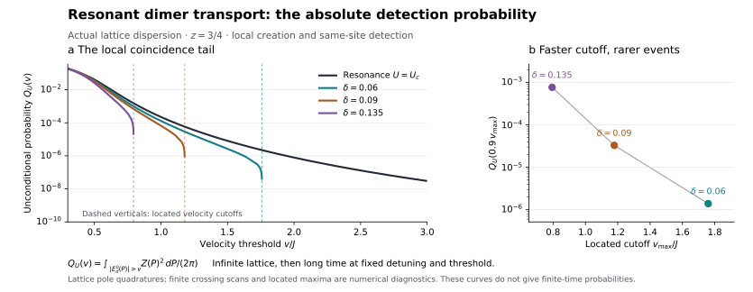

# Resonant Dimer Transport

**What does a local source actually detect when a bound pair has a singular velocity?**

Two distinguishable particles hop on a one-dimensional lattice with a fractional kinetic energy and attract on the same site. At the rest-binding threshold, the persistent same-site coincidence signal has an algebraically unbounded velocity distribution. At any fixed stronger attraction, the same measurement has bounded limiting velocity support.

The result includes the probability cost of local creation and detection, the scattering continuum, and the spatial extent needed to prepare fast dimers with fixed overlap. It is not a claim of efficient superballistic transport.

| Read next | Purpose |
|---|---|
| [Tutorial bridge](research/TUTORIAL_BRIDGE.md) · [Author account](research/AUTHOR_ACCOUNT.md) | Learn from one textbook, then connect its Green's functions to the local-pair measurement. |
| [Theorem](research/THEOREM.md) · [Results index](research/RESULTS.md) | Read the model, exact claims, probability law, and preparation-size result. |
| [Spectral foundation](research/SPECTRAL_PROOF.md) · [Threshold endpoint](research/THRESHOLD_ENDPOINT.md) | Derive the moving pole, contact residue, and exact lattice-edge scaling. |
| [Detuning crossover](research/DETUNING_CROSSOVER.md) · [Joint observation time](research/OBSERVATION_TIME.md) | Follow the global velocity cutoff, its probability cost, and a sufficient observation regime. |
| [Proof map](research/PROOF_MAP.md) · [Transport proof](research/TRANSPORT_PROOF.md) | Locate the complete derivations and their dependencies. |
| [Contribution assessment](research/CONTRIBUTION.md) · [Reproducibility](REPRODUCIBILITY.md) | Check attribution and reproduce all 42 scientific groups and eight infrastructure checks. |
| [LLM guide](llms.txt) | Find relevant research questions, search phrases, and authoritative source files. |

## Physical task

The single-particle dispersion is

```math
\epsilon_z(k)=J[2-2\cos k]^{z/2},\qquad J>0,\quad \tfrac12<z<1.
```

The interaction is $`-U\delta_{x_a,x_b}`$. Prepare $`|0,0\rangle`$, evolve, and measure both positions. The unconditional same-site probability is

```math
C_j(t)=|\langle j,j|e^{-itH}|0,0\rangle|^2.
```

Trials with unequal final positions remain part of the normalization. No initial projection onto a bound band or final energy filtering is supplied.

## Main result

Let $`E_d(P)`$ be the below-continuum dimer energy and $`Z(P)`$ its onsite overlap probability. For every bounded continuous test function $`f`$,

```math
\lim_{t\to\infty}\sum_j f(j/t)C_j(t)
=\int_{-\pi}^{\pi}\frac{dP}{2\pi}\,Z(P)^2 f(E'_d(P)).
```

At resonance, $`E'_d(P)`$ diverges near zero momentum while $`Z(P)`$ vanishes. Both source and detector overlaps matter. The resulting high-velocity coincidence tail is

```math
Q(v)\sim\frac{B_z^2}{\pi(4z-1)}
\left(\frac{zc_zJ}{v}\right)^{(4z-1)/(1-z)}.
```

For $`z=3/4`$ it is proportional to $`(J/v)^8`$: the tail persists but is rare. The limit takes the infinite lattice first, then long time at fixed velocity, and finally high velocity. It is not a fixed-time arrival guarantee or a strict light cone.

A fixed capture probability in a selected fast eigenstate requires relative source radius of order

```math
R_{\min}(v)=\Theta\!\left((v/J)^{1/(1-z)}\right).
```

This is optimal wavefunction support, not a loading protocol. The fastest bound states are spatially large rather than compact molecules.

## Approach to resonance

The finite cutoff has a controlled divergence. With the dimensionless detuning
$`\delta=J(U_c^{-1}-U^{-1})>0`$,

```math
v_{\max}(U)\sim K_z\frac{J}{\delta},\qquad
|P_{\max}(U)|=\Theta(\delta^{1/(1-z)}).
```

For any fixed $`0<\theta<1`$, the unconditional coincidence probability above
$`\theta v_{\max}(U)`$ is of order $`\delta^{(4z-1)/(1-z)}`$. At $`z=3/4`$, better
tuning raises the cutoff as $`\delta^{-1}`$ while its near-cutoff weight falls
as $`\delta^8`$. The [detuning theorem](research/DETUNING_CROSSOVER.md) proves the
global maximum, its momentum scale, and the full probability crossover.
Long time is taken at each fixed detuning first; this is not a finite-time
visibility guarantee.



For $`z=3/4`$, the lattice calculation compares resonance with three positive
detunings. Dashed lines mark the located velocity cutoffs. The right panel
shows the absolute probability above $`90\%`$ of each cutoff: the larger cutoff
comes with a rarer event. These are limiting probabilities per prepared pair.
[Data and reproduction](REPRODUCIBILITY.md#coincidence-tail-figure) include
crossing, quadrature, and source-overlap checks.

## Finite-time accuracy

The [finite-time certificate](research/FINITE_TIME_CERTIFICATE.md) bounds the
error of the same sharp coincidence event at a deterministic observation time.
It combines static spectral variation, band-derivative norms, and a narrow
velocity-shell mass. An event with limiting probability $`q`$ requires continuum
amplitude error small relative to $`\sqrt q`$, rather than $`q`$. A sufficient
time is explicit in these static quantities.

The [joint observation-time theorem](research/OBSERVATION_TIME.md) bounds the
full continuum contact amplitude by $`C/(Jt)`$ uniformly near resonance after
integration over total momentum. Together with sharper band norms, it gives
a sufficient simultaneous time–detuning regime. At $`z=3/4`$,

```math
Jt\delta^7/\sqrt{\log(2/\delta)}\longrightarrow\infty
\quad\Longrightarrow\quad
p_{\delta,t}\sim C_{3/4,\theta}\delta^8,
```

where $`p_{\delta,t}`$ is the actual coincidence probability beyond
$`\theta v_{\max}(U_\delta)t`$, for a fixed $`0<\theta<1`$. The general
fixed-$`z`$ statement is in that theorem. This is a sufficient upper-bound
regime, not a necessary or optimal time scale. Its prefactor has not been
interval-evaluated, so no numerical experimental observation window is asserted.

## One tutorial, then this result

The selected learning anchor is:

> E. N. Economou, **Green's Functions in Quantum Physics**, third edition,
> Springer Series in Solid-State Sciences **7** (2006).
> [Book and contents](https://doi.org/10.1007/3-540-28841-4) ·
> [Single impurity scattering, Chapter 6](https://doi.org/10.1007/3-540-28841-4_6)

Chapters 1–6 connect resolvents, propagation, lattice Green's functions, and
impurity bound states. The [tutorial bridge](research/TUTORIAL_BRIDGE.md) selects
the relevant sections, translates the signs and normalization, and works through
a simple lattice dimer before explaining the two source/detector overlaps.
It then leads into the fractional resonance, velocity law, detuning crossover,
and time-dependent proofs. The route assumes standard quantum mechanics,
Fourier transforms, and basic complex analysis; the repository supplies the
model-specific derivations.

The finite-momentum scattering framework, motion-induced lattice binding, fractional lattice operator, nearby-pair detection, and spectral pushforward methods have explicit predecessors. The assessed contribution is their microscopic, source-resolved resonance contrast, not a new scattering mechanism or general optimization principle.

## Purpose and contact

This repository serves as a record of the work and a guide for the author’s self-directed learning. For discussion or potential collaboration, please contact Ruge Lin at [gogoko699@gmail.com](mailto:gogoko699@gmail.com).

The [LLM guide](llms.txt) supplies relevant questions, search phrases, and direct
links to the scientific reading route.

[MIT license](LICENSE). Linked third-party sources retain their own rights.
